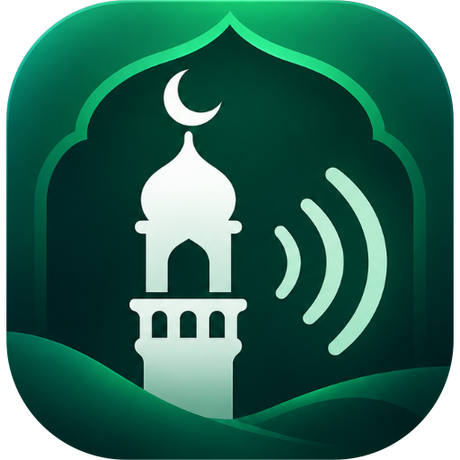
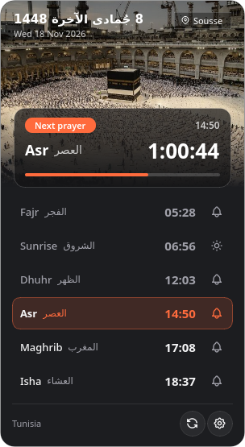
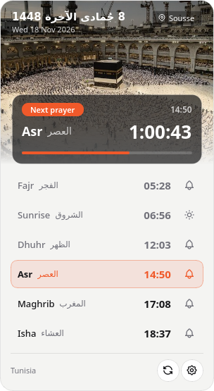
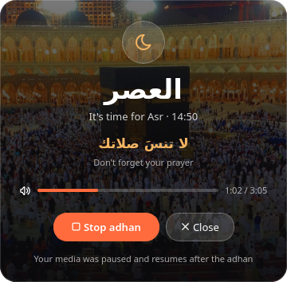
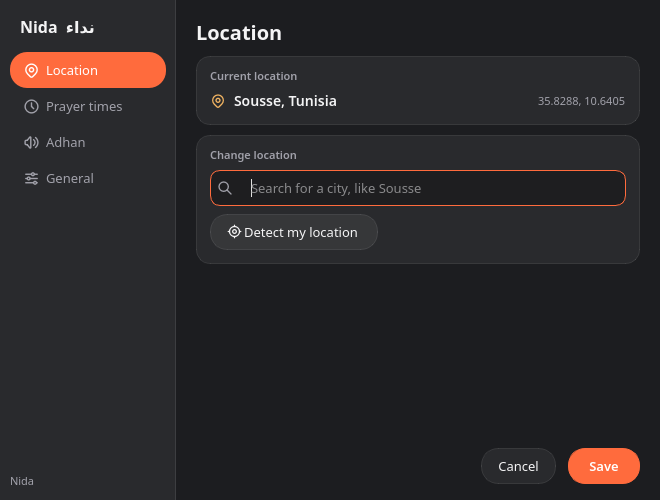
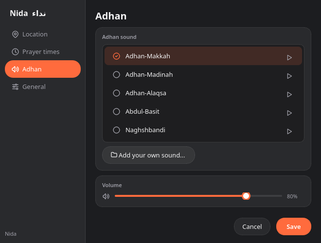
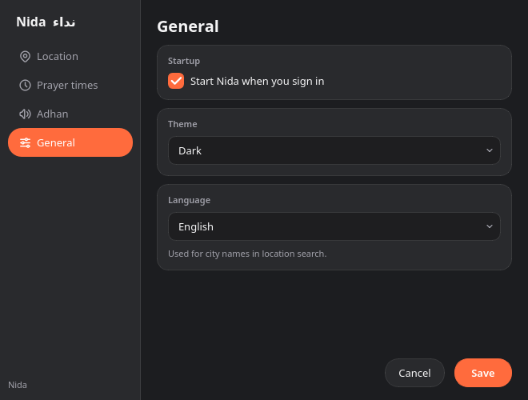

<p align="center">
  
</p>

<h1 align="center">Nida - نداء | Prayer Time App</h1>

<p align="center">
  <b>Pauses your media and notifies you at adhan time — works online and offline.</b>
</p>

---

## Screenshots

| Main window (dark) | Main window (light) | Adhan popup |
|:---:|:---:|:---:|
|  |  |  |

| Settings: location | Settings: adhan | Settings: general |
|:---:|:---:|:---:|
|  |  |  |

---

## Features

- **Media pause/resume** — automatically pauses whatever you're playing (browser, Spotify, video player, anything), then resumes it when the adhan ends or you stop it. Only media that Nida paused is resumed.
- **Adhan popup** — shows the prayer name in Arabic, "لا تنسَ صلاتك", the adhan's progress, a **Stop adhan** button, and **Close** (hides the popup, the adhan keeps playing)
- **Live countdown** — the main window shows the next prayer with a live countdown and progress bar; passed prayers are dimmed and the next one is highlighted
- **Tray icon that tells you the state** — green normally, orange in the last 5 minutes before a prayer, blue while the adhan plays. Stop the adhan from the tray menu too.
- **Dark, light, or match system theme** — with photos of Masjid al-Haram
- **5 bundled adhan sounds** — plus your own MP3 files, with a preview button for each
- **Per-prayer toggle** — enable or disable the adhan for each prayer individually
- **City search + auto-detect location** — search any city, or detect it from your IP
- **22 calculation methods** — Muslim World League, Umm Al-Qura, Egyptian, Karachi, ISNA, Diyanet, JAKIM, Tunisia, Morocco, and more
- **Offline support** — caches prayer times in SQLite, retries automatically when the network comes back, and refreshes at midnight or after the computer wakes up
- **Arabic Hijri dates** — displayed alongside the Gregorian date
- **Autostart** — Settings → General → Start Nida when you sign in

---

## Donate

[](https://buymeacoffee.com/cheriff)

---

## Installation

Download the file for your system from the [latest release](https://github.com/train2128/Nida_Adhan_App/releases/latest).

### Windows

Download `Nida-<version>-Setup.exe` and run it. If an older version is installed, the installer updates it and keeps your settings.

### Linux

| Distro | File | Install |
|---|---|---|
| **Any distro** (incl. Arch, openSUSE) | `Nida-<version>-x86_64.AppImage` | `chmod +x Nida-*.AppImage && ./Nida-*.AppImage` |
| **Debian 12+ / Ubuntu 22.04+ / Mint / Pop!_OS** | `Nida-<version>-Linux.deb` | `sudo apt install ./Nida-*-Linux.deb` |
| **Fedora** | `Nida-<version>-Linux.rpm` | `sudo dnf install ./Nida-*-Linux.rpm` |
| **Other (portable)** | `Nida-<version>-Linux.tar.gz` | `tar xzf Nida-*.tar.gz && ./Nida-*/bin/Nida` (needs Qt 6 installed) |

The AppImage bundles everything it needs, so it's the easiest choice if you're not sure. Use `apt install ./file.deb` rather than `dpkg -i`, so the dependencies are installed automatically.

#### Build from source

Requires CMake 3.20+ and Qt 6.2+ (Core, Gui, Widgets, Network, Multimedia, Sql, Svg, DBus).

**Debian / Ubuntu:**
```bash
sudo apt install cmake g++ qt6-base-dev qt6-base-dev-tools qt6-multimedia-dev \
  libqt6svg6-dev libqt6sql6-sqlite
```

**Fedora:**
```bash
sudo dnf install cmake gcc-c++ qt6-qtbase-devel qt6-qtmultimedia-devel qt6-qtsvg-devel
```

**Arch / Manjaro:**
```bash
sudo pacman -S --needed cmake gcc qt6-base qt6-multimedia qt6-svg
```

Then build and install:
```bash
cmake -S . -B build -DCMAKE_BUILD_TYPE=Release -DCMAKE_INSTALL_PREFIX=/usr
cmake --build build --parallel
sudo cmake --install build
Nida
```

---

## Testing the adhan

You don't have to wait for a prayer time. With Nida running, start some music or a video and run:

```bash
Nida --test-adhan
```

After 30 seconds Nida does exactly what it does at a real prayer time: pauses your media, plays the adhan, shows the popup, and resumes your media when the adhan ends (or when you close the popup).

Options:

- `--delay SECONDS` changes the wait (default 30, max 3600). Example: `Nida --test-adhan --delay 10`
- `--prayer NAME` picks the prayer: Fajr, Dhuhr, Asr, Maghrib or Isha (default: the next one). If the adhan sound is turned off for that prayer, only the popup is shown, just like a real prayer time.

On Windows, run it from the install folder, e.g. `"C:\Program Files\Nida\Nida.exe" --test-adhan`.

---

## Feedback & Contributions

If you have any notes, requests, bug reports, or ideas, feel free to open an issue or contact me. All feedback is welcome.

---

## License

MIT

### Photo credits

- Adhan popup background: [Masjid al-Haram, Tawaf](https://commons.wikimedia.org/wiki/File:Masjid_al-Haram,_Tawaf_20092012_1130PM_(8008466944).jpg) by Basheer Olakara, [CC BY 2.0](https://creativecommons.org/licenses/by/2.0/), cropped and resized.
- Main window header: [Masjid al-Haram 2022](https://commons.wikimedia.org/wiki/File:Masjid_al-Haram_2022.jpg), [CC0](https://creativecommons.org/publicdomain/zero/1.0/), cropped and resized.
